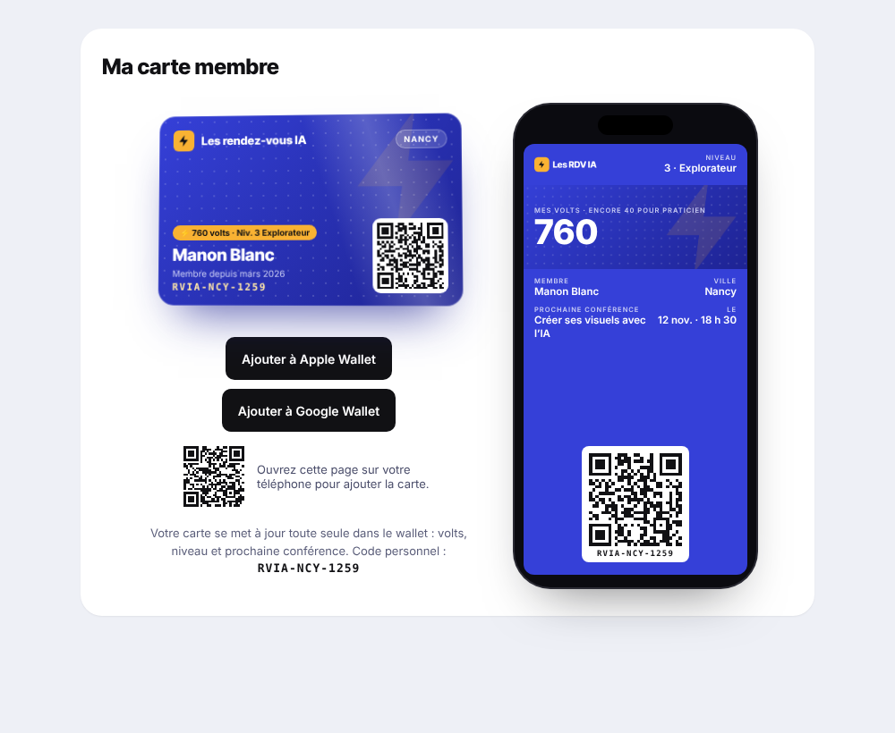

# Carte membre « Les RDV IA » — Wallet

Carte membre virtuelle (site) + pass Apple Wallet / Google Wallet généré et mis à jour via
**The Pass Studio**. Spécification complète : [`docs/SPEC_CARTE_MEMBRE_WALLET.md`](docs/SPEC_CARTE_MEMBRE_WALLET.md).



## Démarrer

```bash
npm install
cp .env.example .env.local   # renseigner les variables (voir ci-dessous)
npm run dev                  # http://localhost:3000/mon-espace
npm test                     # 20 tests (champs, formats, file de synchro, webhooks, révocation)
```

Sans base de données, l'application tourne sur un dépôt en mémoire pré-rempli avec le membre de la
maquette (Manon Blanc, `RVIA-NCY-1259`). Sans clé The Pass Studio, la carte web s'affiche et
`/api/wallet/add` répond 503.

## Variables d'environnement (serveur uniquement)

| Variable | Rôle |
|---|---|
| `PASS_STUDIO_API_KEY` | clé `ps_live_…` (portée restreinte au pass membre si possible). Clé du pass de test en dev. |
| `PASS_STUDIO_PASS_ID` | identifiant du modèle, affiché par `npm run wallet:setup` |
| `PASS_STUDIO_WEBHOOK_SECRET` | secret de signature des webhooks |
| `PASS_STUDIO_BASE_URL` | `https://www.passstudio.online/api/v1` |
| `PUBLIC_SITE_URL` | `https://rendezvousia.fr` (URL des QR et des images du pass) |
| `WALLET_PUSH_INTERVAL_MS` | espacement entre deux pushs (rate limits) |
| `CRON_SECRET` | protège `POST /api/cron/wallet-sync` |

Aucune n'a le préfixe `NEXT_PUBLIC_` ; `lib/wallet/config.ts` refuse d'être chargé côté navigateur.
Le build a été vérifié : ni la clé ni l'URL de l'API ne figurent dans `.next/static`.

## Création du modèle de pass

1. Héberger `public/wallet/*.png` en https public (servis tels quels par le site : `https://rendezvousia.fr/wallet/…`).
2. De préférence, créer le modèle dans l'**éditeur The Pass Studio** (type `loyalty`, distribution `unique`),
   appliquer le design de `lib/wallet/design.ts` et placer les champs du §3.3 :
   `level` (en-tête), `volts` (principal), `progress`, `memberName` / `city` (secondaires),
   `nextTitle` / `nextWhen` (auxiliaires), `memberSince`, `memberCode`, `nextFull` (verso),
   `howTo` (verso, **champ du modèle**).
3. `PASS_STUDIO_PASS_ID=… npm run wallet:setup` vérifie que toutes les clés sont présentes et que
   `publishBlockers` est vide. Sans `PASS_STUDIO_PASS_ID`, le script crée le modèle via `POST /passes`.
4. `npm run wallet:setup -- --publish` publie le modèle (`status: active`).
   En développement, garder un pass de test séparé en `draft`.

## Architecture

| Fichier | Rôle |
|---|---|
| `lib/wallet/passstudio.ts` | **seul** client HTTP The Pass Studio (issue, `PATCH /instances/fields`, revoke…) |
| `lib/wallet/fields.ts` | calcul des champs du pass depuis notre base + hash anti-push inutile |
| `lib/wallet/levels.ts`, `format.ts`, `code.ts` | niveaux, dates FR (Europe/Paris), code `RVIA-XXX-0000` |
| `lib/wallet/service.ts` | création de carte, émission, file de synchro (regroupement 2 min, priorité des notifications, 202/402/5xx), webhooks, révocation |
| `lib/wallet/webhook.ts` | vérification HMAC sur corps brut, fenêtre 5 min, temps constant |
| `lib/wallet/repository.ts` | interface d'accès aux données — à implémenter sur `db/schema.sql` |
| `components/MemberCard.tsx` | carte web 3D (§2.2), animations coupées par `prefers-reduced-motion` |
| `components/WalletPreview.tsx` | aperçu du pass dans un cadre de téléphone 270 × 540 |
| `app/mon-espace` | espace membre : carte, boutons wallet, aperçu |
| `app/admin/membres/[memberId]` | fiche admin : carte, code, wallet utilisé, copier / renvoyer / révoquer |
| `app/carte/[code]` | page du QR (selon le rôle, neutre sinon, limitée en débit, jamais de pointage) |
| `app/api/wallet/add` | redirection vers Apple / Google (émission au premier clic si besoin) |
| `app/api/webhooks/passstudio` | `pass.issued` / `pass.updated` / `pass.removed` |
| `app/api/cron/wallet-sync` | traite la file — à appeler chaque minute |

### Brancher les événements métier

Après écriture en base, appeler :

- `onVoltsAwarded(ctx, memberId, { before, after, source })` — `attendance` / `referral` notifient, le reste est silencieux ; le passage de niveau notifie et prime ;
- `onBookingConfirmed(ctx, memberId, { conferenceTitle, startsAt })` ;
- `onSilentChange(ctx, memberId, "booking_cleared" | "profile")` — annulation, conférence passée, nom, ville ;
- `createCardForMember(ctx, memberId)` à l'inscription ; `cardEmailBlock()` dans les e-mails (bienvenue, réservation, J-3, renvoi).

## Test sur téléphone

1. Déployer en https (les URLs des images et de `/carte/…` doivent être publiques).
2. Se connecter sur iPhone → `/mon-espace` → « Ajouter à Apple Wallet ». Comparer avec `docs/rdvia-rendu-cible-apple-wallet.png`.
3. Même chose sur Android → Google Wallet, faire une capture.
4. Vérifier que la fiche admin passe à « Apple Wallet » / « Google Wallet » (webhook `pass.issued`), puis « Non ajoutée » après suppression.

## Écarts et points à valider

La documentation The Pass Studio (`thepassstudio.com/docs/integrations`) **n'a pas pu être consultée**
depuis l'environnement de développement (domaine bloqué par la politique réseau). L'intégration suit
donc la spécification interne ; les points suivants sont marqués `À VÉRIFIER` dans le code et doivent
être confrontés à la doc avant la mise en production :

1. **Authentification** : `Authorization: Bearer <clé>` supposé.
2. **Publication du modèle** : `PATCH /passes/{id}` avec `status: "active"` supposé (il peut exister un endpoint dédié).
3. **`barcodeType`** : `"QR"` provisoire.
4. **Texte sous le QR** : on envoie `barcodeValue` = URL de la carte et `showBarcodeText: true`. Si The Pass Studio
   affiche forcément la valeur encodée (l'URL) et n'a pas de texte alternatif, il faudra choisir entre l'URL
   affichée sous le QR, ou masquer le texte (le code reste visible au verso via `memberCode`).
5. **Retrait du lieu** : on envoie `locations: []` ; la doc peut exiger `null`. `locations` est aussi envoyé à l'émission — à confirmer.
6. **Forme des réponses** (`instanceId`, `artifacts.*`, `pushSkipReason`, erreurs `{ code, retryable }`) et des
   webhooks (`data.instanceId`, `data.platform`, horodatage en secondes ou ms) : lecture défensive en place.
7. **Rate limits** : espacement fixe `WALLET_PUSH_INTERVAL_MS` (250 ms) faute de connaître les limites exactes ; à aligner sur la page rate-limits.
8. **Régénération** : l'émission est idempotente par `customerId`. Une carte régénérée utilise
   `member_<id>_<nouveau code>` (sinon l'API renverrait l'instance révoquée). La 1re carte garde `member_<id>`.
9. **Libellé de `progress`** : la maquette met « Encore 40 pour Praticien » dans le libellé de « MES VOLTS ». Un libellé
   Apple est en principe fixe ; si l'éditeur ne permet pas de le rendre dynamique, `progress` sera un champ séparé
   (ligne sous le principal ou champ secondaire).

Écarts côté produit :

- **Paliers de niveau** : seuls « 3 · Explorateur » et « 4 · Praticien » (800 volts) sont connus. Les noms et seuils
  des niveaux 1, 2, 5 et le seuil du niveau 3 dans `lib/wallet/levels.ts` sont **provisoires** — à fournir.
- **Badges wallet officiels** : non inclus (à télécharger chez Apple et Google, en français). Boutons provisoires
  en attendant ; déposer les SVG dans `public/wallet/badges/` et passer `OFFICIAL_BADGES` à `true`.
- **Authentification, base de données et envoi d'e-mails** : le dépôt était vide. Points de branchement :
  `lib/app/auth.ts` (session et rôles), `lib/wallet/repository.ts` + `db/schema.sql`, `TODO` e-mail dans les routes admin.
- **Polices** : Inter / Inter Tight chargées depuis Google Fonts.
- Heures pile affichées « 9 h » (et non « 9 h 00 »).
- Les écarts inévitables du §3.4 (volts en blanc, pas de barre de progression ni d'animation dans le pass, mise en page Google) s'appliquent.
